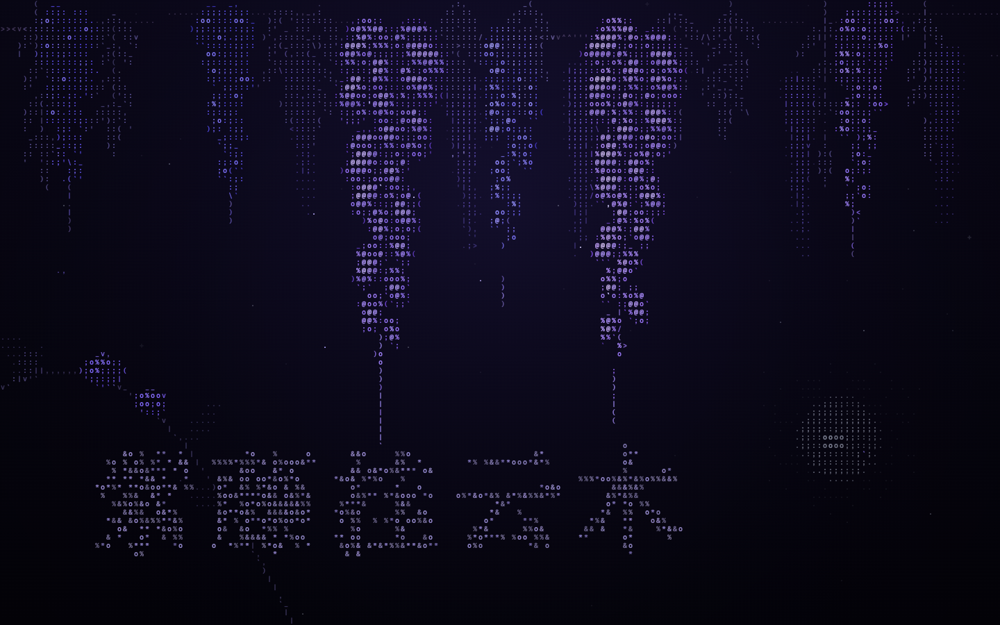

# ascii wisteria

English · [简体中文](README.zh-CN.md)

```
  :::,  ,;;:_ _;ooo;:::            ::::_  _:;%@@%;@@::o%%o;
 ::):: :@@@@%:;@o;o%;:::>         ::: :: _;@@@@@o;;o:@%oo%@
\::)::::oo:;o;;:o@%;::_::        ::::: :(:@@@@@;@@%o@:;@@o;
::` ::;@@oo%o;;:%@@@o:::,_       ::: :: `:@@@@o%@;@@;:o@@@@
`_::::@@@;@;@@:;:o%@%o:::,      ::' ) ::  ::;o%;;@@@o::%@@@
,:' ::%%%::%@@;;;:;oo;: `|     v' _:::,`  :@@@@;;@@@o:;:o%%
: ,<:oooo;;%@%;;@@%;:':,         ,:: ):: :@@@@;@:@@%:::%;;;
_:'::;%%o;o:o;:;@@@@;(`|         ::,:,':::@@@@;%:;o;:@@;o%%
:` : :::%;:@@o:;;%%%%:          /::::::/:::;oo%:@@@@;;;;:::
  ::: `:%@;@@%:;;:;oo: v        ,:|::`::;;:@@@;;%@@%:%@@@o:
  ::: :@@@%;o;;@;;;;::;;;;;     '  ::  ':;;:;:%@;%%::;@@@@%
  ):` ;@@%:;%@o;;:``::;;;;;        ::    ;;;;:o;@@%%;;;%@@@
   :  `o%@@:%@%:o@: ::;;;;;        ::    |;;;o%;@@@%;@%;;oo
      ;@@@%:;%o;o;: `;;;;;;        `      ;;:o%;@@@;o@@@;,
     )o@@o:;o;oo@@o:  ;;;;;               ;;;@@oo%o;%o@@@:
      ```  ;%;%%o@%;/ ;;;;                ;:@@@@::ooo@;@%:
          )@@%;o;oo;  ;;;|                ;:o%oo@;@@%;`''
       o%%:%@%:;; `   ;;;;                ;;:o@@o:@@%:
      ;%%o%;%;@@:      ;;;                ;;o@@@%:;%;%o,
      @@@@;;`:%%;      ;;                  :@@@@::@;;o@o
     o@@@o:oo;`;`      ;;                  |o%;:o;:@@@;;
     ;o;: ;%;@;        ;;                     ;@%%:%@@@;
      ;@@%%@%;         ;;                     oo@@::@@@o(
      o%%;;@o                                  o@@;%;oo;
     o@@@;:::                                  ;%;oo%o
    )%@@o` %o%o                             o@@%;:@@@:
     ```  );@@;`                           :@%%%@:o@@;
       o%%)`%@%:                           ;@@@o; `;o:
      ;%%o; `;o`                          )@@@@ )_o
      ;@@;;                               `o%;` oo%@;
      ;o;)oo%;                                  :@@o;
          ;@o:                              o%@o;%@@(
        _;:%%:                              %@%%(`oo`
       %%; `;                              ;@@@:
       @@;                                 ;@%` o%_
       ;`|                                     ;%%o
         o     '                               |o@;
         `                                    %o o`
                  `                           %(
        |                                      (
        )
        |                                      (
        (                                     )
        (                                     |
                                              ;
```

A moonlit curtain of wisteria drawn as ASCII on a canvas. Give it a photograph and the photograph comes alive: racemes sway in the wind and swing aside when your cursor passes. Petals drift down from the flowers and gather on the ground, and your cursor leaves a thread of fragrance that lingers for a few seconds. With no photograph, it draws its own illustrated wisteria. Zero dependencies.


```sh
npm install && npm run dev
```

```ts
import { WisteriaEngine } from "./src";

new WisteriaEngine(canvas, { image: "/wisteria.jpg" }); // give the canvas a monospace font-family
```

**Choosing a photograph.** It works best with wisteria hanging from the top of the frame, against a dark background, with a few racemes in focus. It is cover-fitted to the canvas. Without `image`, the engine draws its built-in illustration, and it falls back to that if the image fails to load.

## The idea

| | |
|---|---|
| **Romance** | Everything is slow: racemes swing on a 4–7 s rhythm and petals fall at walking pace. Two old vines twist around each other along the trellis. |
| **Longing** | Your cursor leaves a thread of fragrance that rises and curls like incense, cooling from `*` to `.` over a few seconds. Fallen petals pile up and fade over about a minute. Now and then a petal stops mid-air for a moment, as if looking back. A low moon sits in the empty lower right. |
| **Noble, calm** | One blue-violet ramp carries the scene. Leaves and bark are pushed to grey-lavender, so nothing competes with it. The only accent is moonlight. |

The composition follows a night photograph of wisteria: two large, sharp
racemes caught in a moonbeam, the rest falling away into soft, sparse bokeh,
and a blurred vine framing the lower-left corner.

### What you'll see

- **Growth opening** (~18 s): the vine reaches across, racemes lengthen, buds open from the top down, then the first petals fall. Click to skip.

  

- **Fragrance**: the cursor is a breeze that pushes racemes aside as it passes. It is also a small lantern that lights the florets near it. Behind it, evenly spaced motes take a little of its speed, then slow, rise and curl, with fainter wisps feathering off to the sides. Florets they drift past light up for a moment.
- **Ripple**: a click sends out an ASCII ring that eases outward over about 3 s, followed a beat later by a fainter dotted echo. Racemes swing and shed petals only when the ring reaches them, and fallen petals it passes over flutter back up, so the click spreads through the scene as one wave.
- **Poem**: once in a long while, falling petals gather into a line of Li Bai's *Wisteria* (紫藤树), hold it for a few breaths, and let it go.

  

With `prefers-reduced-motion`, you get a single still frame in full bloom. Rendering pauses while the canvas is off-screen.

## Options

```ts
new WisteriaEngine(canvas, {
  image: "/wisteria.jpg",   // a photograph to bring to life; omit for the illustration
  intro: true,              // opening (reveal or growth); false starts in full bloom
  poem: ["香风留美人"],      // your own lines, or false to turn the poem off
  poemDelay: 45,            // seconds after the intro before the first poem
  poemEvery: [150, 260],    // seconds between poems
  density: 1,               // racemes per width, relative
  wind: 1,                  // wind strength, relative
  palette: { skyTop: [12, 9, 30] }, // override any colour of the moonlight palette
});
```

Demo URL params: `?image=0` (illustration), `?image=/other.jpg`, `?intro=0`, `?poem=0`, `?poem=line one|line two`, `?poemDelay=0`. The demo expects a photograph at `public/wisteria.jpg`.

React:

```tsx
import { AsciiWisteria } from "./src/react";

<AsciiWisteria className="hero" options={{ intro: false }} />;
```

The poem needs room: each character must be at least 8 cell rows tall, so narrow phone screens skip it. Over a photograph, the poem runs vertically through the darkest gap between racemes.

## How it works

The key idea: **paint the plant as a real illustration first, then turn that picture into glyphs.** If the picture reads as wisteria, the ASCII will too. Choosing glyphs by brightness alone gives purple noise. Shape comes from a few large silhouettes with dark air between them, flat surfaces inside each petal, and outlines that follow the petals.

Some subjects are hard to illustrate convincingly: our hand-drawn florets kept looking like grapes. So the engine can take the source picture from a photograph instead. Either way, a picture is converted to glyphs every frame.

Like [ascii-sharks](https://github.com/stackedlol/ascii-sharks), which inspired this project, the engine is layered:

- **`world.ts`: physics in pixels.**
  - Each raceme is a 14-node verlet chain pinned to a branch. A little bending stiffness makes it swing as a whole.
  - Florets hang off it to the left, to the right, and (on the dense upper part) toward the viewer. They are big and overlapping at the top and paired lower down, ending in closed buds.
  - Sizes are fractions of the screen, so the composition holds at any size: two large hero racemes, a few mid-distance ones kept clear of them, soft ones behind, and a canopy of pinnate leaves along the top.
  - Wind is two slow swells plus gusts on a ~40 s rhythm. The pointer's velocity pushes nearby nodes. Only a ripple's front pushes, so swings travel outward.
- **`photograph.ts`: the picture, from a photo.**
  - The photo is cover-fitted and drawn into the sample canvas (5 × 8 samples per cell) in tiles that follow 40 pendulum columns.
  - Each column is a damped pendulum with a period of about 5 s, and its sway grows with distance from the top. Hanging racemes swing as a whole while the canopy barely moves. Wind, the pointer and ripple fronts drive the pendulums.
  - Bright pixels become the places petals fall from.
  - The opening reveals the photo from the top down, column by column.
- **`illustrator.ts`: the picture, drawn (no photo).** Every frame is drawn with vector shapes on an offscreen canvas, at 4 × 6 samples per text cell.
  - Each floret is a broad banner petal flaring up and back, plus a cupped keel hanging out on a short stalk. Both are lit from the upper left, with a moonlit edge and a dark outline.
  - Far racemes are soft overlapping discs, which become bokeh.
  - Leaves are lance-shaped with a midrib.
- **`renderer.ts`: picture to glyphs.** For each cell, it reads the samples back.
  - **From a photo**, each cell takes the glyph whose bitmap best fits the cell's pattern of light relative to its brightest sample, inked in the photo's own colour at that brightness. `@` fills about 90% of cells, so it is tried first (and flat cells skip matching entirely), which lets the other candidates stop early.
  - The photo layer is refreshed over a three-frame cycle (top half, bottom half, repaint), so no frame carries the whole cost. Overlays redraw every frame.
  - **From the illustration**, it works as follows.
  - **Flat cells** take a glyph from a short ramp, `.:;o%@`, on a gamma curve, so one petal reads as one surface and colour carries the shading.
  - **Edge cells** (part-covered, high contrast) are matched by shape against stroke glyphs (`/ \ | ( ) _ ' , ^ v`), so outlines follow the petals.
  - **Dim cells** become a single soft dot.
  - Each glyph takes the covered pixels' own colour, brightened as a whole so highlights stay violet.
  - Moon, stars, falling petals, fragrance motes, ripples and the poem are drawn directly as glyphs on top.
- **`poem.ts`: text to cells.** A line is drawn at 4× resolution per cell on a scratch canvas. Cells that are more than 30% covered become targets, and petals glide onto them, slowing so they settle without overshooting.

## Skill

[`skills/ascii-living-art`](skills/ascii-living-art/SKILL.md) is an agent skill for Claude Code and compatible agents. It teaches the method behind this project (feeling → simulation → fields → glyph ramps → palette), so you can grow other living ASCII pieces: cherry blossom, jellyfish, fireflies. It also covers embedding and tuning this wisteria. To install it, copy the folder into `~/.claude/skills/` (or your project's `.claude/skills/`).

## Credits

- Architecture inspired by [stackedlol/ascii-sharks](https://github.com/stackedlol/ascii-sharks). No code was copied; everything here is written from scratch.
- Verse: Li Bai, *Wisteria* (李白《紫藤树》).

## License

MIT
